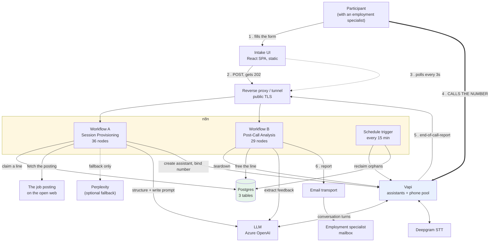
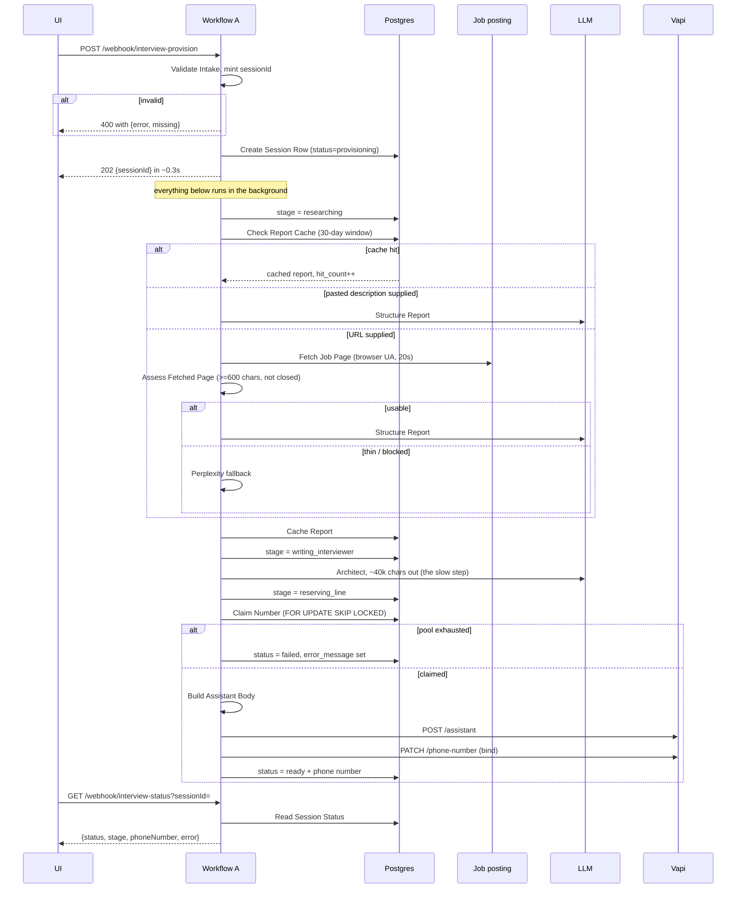
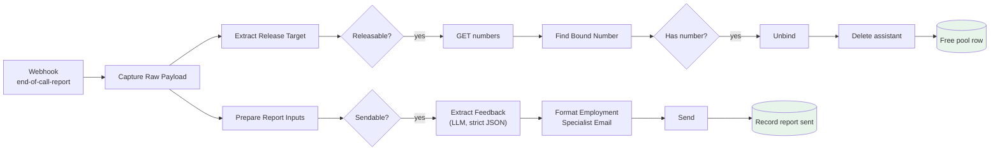
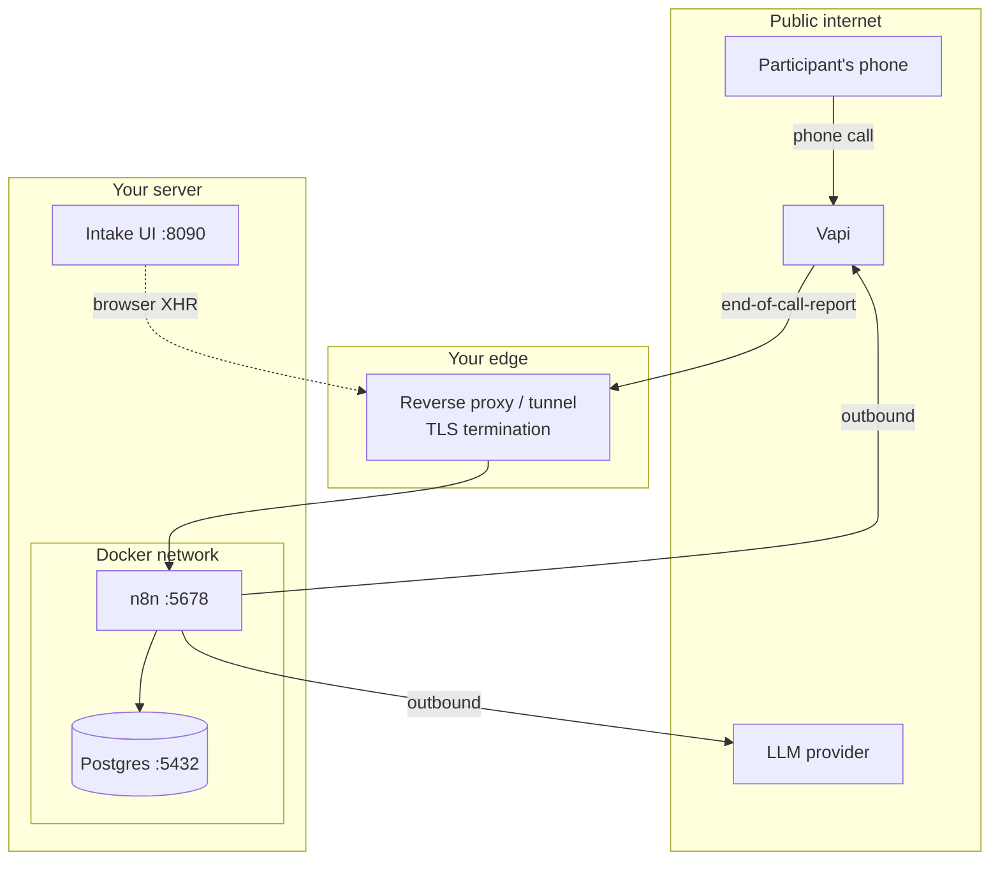

# Interview Practice AI: Master System Playbook

**The single source of truth for this system.** Written for someone with zero prior context who is
technically competent: a sysadmin, an IT team, or another AI agent. If you read one document before
touching this system, read this one.

**Status of this document.** Every claim is traceable to a file in this repository or to a measured
observation from the reference deployment. Where a figure was measured, the measurement is given.
Decisions each deployment makes for itself are flagged where they come up and collected as a
checklist in [§9](#9-before-you-go-to-production).

---

## Table of contents

1. [Executive overview](#1-executive-overview)
2. [Architecture](#2-architecture)
3. [Infrastructure and environment layout](#3-infrastructure-and-environment-layout)
4. [Build history: what was done and why](#4-build-history-what-was-done-and-why)
5. [Setup and replication guide](#5-setup-and-replication-guide)
6. [Operations runbook](#6-operations-runbook)
7. [Access, permissions and security](#7-access-permissions-and-security)
8. [Glossary and reference](#8-glossary-and-reference)
9. [Before you go to production](#9-before-you-go-to-production)

---

## 1. Executive overview

### For a non-technical stakeholder

Mock interviews are one of the most valuable things an employment specialist does and one of the most expensive in
staff time, so most job seekers get one rehearsal or none at all. This system makes that practice
unlimited without adding a single hour to anyone's caseload. A participant fills in a short web form
about a job they are applying for. About two minutes later the screen shows a phone number. They call
it and have a real spoken conversation with an AI playing the hiring manager **for that specific
job**: not a generic interview, but one built from the actual posting. At the end the AI steps out
of character and talks them through how they did. Their employment specialist then receives an email with the
full transcript, the feedback the participant heard, and notes to work from. The employment
specialist still leads; the system produces the record they work from.

### For an engineer seeing this for the first time

Two n8n workflows wrap the Vapi voice platform, linked by metadata stamped on each assistant at
creation time. Workflow A takes a form submission, researches the job posting (direct page fetch
structured by an LLM, with a search-API fallback), generates a bespoke ~40,000-character interviewer
system prompt, atomically claims a phone line out of a Postgres pool, creates a Vapi assistant, binds
the number to it, and answers. Because that takes 90–140 seconds (longer than a proxy will hold an
HTTP request open), provisioning is **asynchronous**: the webhook returns `202` in ~0.3s and a React
single-page app polls a status endpoint every 3 seconds. Workflow B receives Vapi's
`end-of-call-report` webhook and fans out two independent branches in parallel: one tears the session
down (unbind number, delete assistant, free the pool row) and one extracts the spoken feedback from
the transcript and emails the employment specialist. A 15-minute scheduled sweep reclaims lines provisioned for
people who never called, and reconciles the database against Vapi.

The three problems worth understanding before changing anything are **identity across the call
boundary** (solved with Vapi `metadata`), **concurrency on a tiny phone-number pool** (solved with
`FOR UPDATE SKIP LOCKED` in Postgres, because the voice platform offers no conditional bind), and
**teardown** (nothing is ever released unless you release it; the pool silently exhausts otherwise).

### What it is not

- Not a scoring engine with an adopted rubric. See §9: the rubric in `prompts/` is a **draft for an
  employment specialist to correct**, not an adopted standard.
- Not multi-tenant. One deployment serves one organization.
- Not authenticated. Anyone who can reach the form can provision a session. See §7.

---

## 2. Architecture

### 2.1 Component inventory

| Component | What it does | Why it is there | Required? |
|---|---|---|---|
| **n8n** | Hosts both workflows; the entire orchestration layer | Everything except the UI is n8n nodes. No application server exists. | **Yes** |
| **Postgres** | Phone-line allocator, session ledger, job-report cache | The allocator cannot be done anywhere else (see §2.4) | **Yes** |
| **Vapi** | Telephony, speech-to-text, text-to-speech, call orchestration | Provides the phone numbers and runs the live conversation | **Yes** |
| **LLM** (Azure OpenAI in the reference build) | Structures job postings, writes the interviewer prompt, extracts feedback | Three distinct jobs, same model | **Yes** |
| **Deepgram** | Speech recognition during calls | Configured through Vapi, not called directly | Yes (via Vapi) |
| **Intake UI** | React SPA: the participant-facing form | The only thing a participant touches | **Yes** |
| **Email transport** (Microsoft Outlook OAuth2 in the reference build) | Delivers the employment specialist report | Swap for SMTP/Gmail freely; it is one node | **Yes** |
| **Perplexity** | Research fallback when a page cannot be fetched | Optional. Primary path is a plain fetch + LLM, which measured *better* | No |
| **Reverse proxy / tunnel** | Public TLS endpoint for n8n | Vapi must reach the report webhook from the internet | **Yes** |

### 2.2 System diagram



### 2.3 End-to-end data flow

**Provisioning (Workflow A).** Verified node order, exported from the running instance:



**Post-call (Workflow B).** The two branches fan out from one node **in parallel**, deliberately:
a slow LLM call must never delay returning a phone line to the pool.



### 2.4 Design decisions you must not undo without understanding them

| Decision | Why | Undo it and… |
|---|---|---|
| **`FOR UPDATE SKIP LOCKED` to claim a line** | Vapi has **no conditional bind**. Two near-simultaneous runs reading "first number with a null assistantId" both pick the same line and the second clobbers the first. | A participant is handed a dead number. This happened; it is why the table exists. |
| **Provisioning is asynchronous (202 + poll)** | Provisioning takes 90–140s. A proxy in front of n8n (Cloudflare's default is 100s) kills a request held that long. A real submission succeeded while the browser showed an error. | Successful sessions display as failures. |
| **The session row is written *before* any slow work** | The status endpoint has to have something to read from the moment the 202 is returned. | The poll 404s for two minutes. |
| **Teardown and reporting run in parallel branches** | The LLM extraction takes seconds to tens of seconds. Phone lines are the scarce resource. | Lines stay held while an email is composed. |
| **Pool ownership is enforced by NAME (`^INTERVIEW-\d+$`)** | The same Vapi account may hold production lines. Every unbind is gated on the name. | The sweep can unbind a production phone line. |
| **Reconciliation hangs off its own branch of the trigger** | A node that emits zero items silences everything downstream of it. Reconciliation sat behind a filter and silently never ran on quiet ticks. | Drift between Vapi and the database goes uncorrected. |
| **The report *forwards* the spoken feedback rather than re-scoring** | The assistant already delivers an assessment out loud. Re-scoring independently means the participant hears one thing and their employment specialist reads another. | Participant and employment specialist get divergent assessments. |
| **No tools on the assistant** | The interviewer needs none, and a tool is one more thing that can misfire mid-call. | Unpredictable call behaviour. |

### 2.5 Locked invariants

These are **machine-checked** by `tools/deployed.py check`, not merely documented. They were locked
after live phone testing in the reference deployment. Keep the checker in CI or in your pre-demo
routine.

**1. Voice configuration is pinned.**
```js
voice: { provider: 'vapi', voiceId: 'Elliot', speed: 1.2, version: '2', language: 'auto' }
```
`version: '2'` is the v2 voice model: opt-in per assistant, and more natural at lower cost. The
string form (not the number `2`) is deliberate: that is what the API echoes back.

**2. The applicant's first name is spoken exactly ONCE per call.** The platform speaks
`firstMessage`, which already contains the name. Nothing else may use it. Enforced in three
independent places so one drifting generation cannot break it: the architect prompt's *The name*
section, the same file's acceptance criteria, and a "Platform Delivery Rules" block bolted on inside
`build-assistant-body.jsCode.js` that overrides the generated prompt. The only exception is the
closing coach voice, which may use it once.

> Origin: the original prompt *required* the name in the opening turn, which double-counted against
> the platform greeting. Hearing your own name twice in ten seconds reads as a script, not a person.
> After the fix the name appeared exactly once in a 40,922-character prompt, down from eight times.

**3. The assistant declares no tools.**

---

## 3. Infrastructure and environment layout

### 3.1 What has to run where

| Thing | Placement requirement | Why |
|---|---|---|
| n8n | Must be reachable from the public internet over TLS | **Vapi calls your report webhook.** This is the hard one. |
| Postgres | Reachable from the n8n container | Same Docker network is simplest; the host is `postgres`, not `localhost`, from inside a container |
| Intake UI | Reachable by participants | Static files. Any web server, or the bundled Python one |
| Vapi, LLM, email | SaaS | Outbound HTTPS only |



### 3.2 The public-reachability requirement

**This is the most common deployment failure.** `server.url` on every assistant points at your report
webhook. Vapi calls it **from their infrastructure**. A `localhost`, `127.0.0.1`, or LAN address
there means calls work perfectly and **no report ever arrives, with no error anywhere**.

Any of these work: a reverse proxy with a public DNS name and TLS, a Cloudflare Tunnel, ngrok for
testing. If your proxy has an origin-response timeout, note that provisioning already returns in
0.3s, so only the report webhook matters, and it responds `onReceived`, immediately.

### 3.3 Scaling behaviour and limits

| Dimension | Limit | Behaviour at the limit |
|---|---|---|
| **Concurrent interviews** | **= number of rows in `interview_number_pool`** | Participant N+1 gets a readable "all practice lines are busy". No failure, no overwrite. Verified: 3 simultaneous submissions → 3 different numbers. |
| Provisioning latency | 90–140s cold; the architect step dominates | Progress bar is designed to cover it |
| Call duration | `maxDurationSeconds` (1800 in the reference build) | A safety cutoff, not a target. Real interviews measured **3–7 minutes**; nothing has ever hit the cap |
| Research provider | Some tiers allow one concurrent request | The cache absorbs repeats; retry with backoff on 429 |
| Database | Measured ~4.2 KB per session, ~12.7 KB per unique job posting | 10,000 sessions/year ≈ 79 MB/year |

**Scaling up means buying more phone numbers and adding rows.** Nothing else is the bottleneck.

---

## 4. Build history: what was done and why

Reconstructed from the reference deployment's build log. Included because it prevents
re-litigating settled questions.

| Phase | What happened |
|---|---|
| **Recon** | An earlier prototype existed and was abandoned, not repaired. Its expressions were written against *assumed* node output shapes and every one was wrong. **The rule that came out of this: run the node, look at the real output, then write the expression.** |
| **Phase 1: provisioning** | Webhook → research → architect → create assistant → bind number → respond. Assistant config was harvested from a live, caller-facing agent rather than designed from scratch. |
| **Phase 2: reporting** | Deliberately built *after* capturing and inspecting a real `end-of-call-report` payload. The capture node interpreted nothing at first; it just logged the shape. |
| **Phase 3: survive an audience** | The atomic claim and the teardown/sweep. Verified with three simultaneous submissions. |
| **Research step inverted** | The original design called for a search API to "research the job listing." Measured, it searched *around* the URL rather than reading it, and **missed the stated hourly wage**. A plain page fetch plus the LLM produced a 13,405-character report that captured the wage, the bonus, and the software named in the posting, with 16 "not stated" honesty markers against 1. The search API was demoted to a fallback. |
| **Pasted description added** | Many postings cannot be fetched at all: career sites that block automation, logins, roles only ever emailed. A paste is now a first-class input, not a fallback. Verified against a wholly fictional listing with no URL, which proves the paste was the only source. |
| **Architect prompt rewritten** | From a cold interviewer to a mock interview *with training wheels*: in-character nudges capped at two per issue, a hard line between a nudge and coaching, support that rises when the applicant struggles, and a permanent role-flip to a coach voice at the end. Cost: the prompt grew from ~20k to ~40k characters and the cold path from 78s to 95s. |
| **Provisioning made asynchronous** | Forced by a real failure: a submission provisioned successfully in 139.9s while the browser showed an error. |
| **Durable UI hosting** | The dev server died three times across sessions. Replaced with a static server under a supervised service. |

### Tried and abandoned (do not revisit without new information)

- **Search-API-first research.** Measured worse than a page fetch. Kept only as a fallback.
- **A structural "reference example" prompt** fed to the architect. It was a different *kind* of
  prompt (a receptionist with a knowledge base) and became actively misleading once the architect
  specified its own structure. Retained in `prompts/` but not wired in.
- **Re-scoring the transcript independently of the spoken feedback.** Guarantees divergence between
  what the participant hears and what the employment specialist reads.
- **Relying on a task scheduler's restart-on-failure for the UI service.** Tested: killing the child
  process did *not* trigger a restart. Fixed with a supervising loop plus a repeating trigger.

---

## 5. Setup and replication guide

Full step-by-step with validation gates: **[docs/SETUP.md](docs/SETUP.md)**.

Order matters. Each step has a check; do not proceed past a failed check.

| # | Step | Validation |
|---|---|---|
| 1 | Postgres running, `db/schema.sql` applied | `\dt interview_*` shows 3 tables |
| 2 | n8n running and **publicly reachable over TLS** | Fetch your n8n URL from outside your network |
| 3 | Create the five n8n credentials with the exact names in `.env.example` | Each saves without error |
| 4 | Provision phone numbers in Vapi, named `INTERVIEW-01…NN` | `GET /phone-number` lists them as `active` |
| 5 | Seed `interview_number_pool` with one row per number | All rows show `free` |
| 6 | Import both workflows from `workflows/` | 36 and 29 nodes, no missing-credential warnings |
| 7 | **Set the report webhook URL** in `Build Assistant Body` | It is a public `https://` URL |
| 8 | Activate both workflows (deactivate/activate after any structural change) | Provision webhook returns 400 on `{}`; status returns 200 |
| 9 | Configure and build the UI | `npm run build` succeeds; bundle contains your webhook URLs |
| 10 | **One real end-to-end run** | Submit, call, reach the spoken feedback, hang up, confirm the email |

**Step 10 is the only one that proves the system works.** Steps 1–9 can all pass while the report
webhook is unreachable and no report ever arrives.

---

## 6. Operations runbook

### 6.1 Monitoring

| Signal | Where | Healthy |
|---|---|---|
| Workflow runs | n8n → Executions | Provisioning runs ~90–140s and succeeds |
| Free lines | `SELECT count(*) FILTER (WHERE session_id IS NULL) FROM interview_number_pool;` | Equals pool size when idle |
| Stuck sessions | `SELECT * FROM interview_sessions WHERE status='provisioning' AND provisioned_at < NOW() - INTERVAL '10 minutes';` | Empty |
| Deployed drift | `python tools/deployed.py check` | All identical, all invariants OK |
| UI | `python tools/serve_ui.py --check` | Exit 0 |

> **Execution-log noise.** The UI polls every 3 seconds, and **each poll is a logged n8n execution**:
> roughly 35 per session. Combined with a 15-minute sweep (96/day), real runs get buried and
> retention shrinks to days. Before launch, either lengthen the poll interval or disable saving
> successful executions for the status path.

### 6.2 Failure modes

| Symptom | Likely cause | Fix |
|---|---|---|
| Form submits, then times out at 5 min | A node threw mid-run; row stuck at `provisioning` | Resubmit; the sweep frees the line. The error handler in §9 (item 9) surfaces the real error to the participant |
| "All practice lines are busy" | Pool genuinely exhausted | Expected. Wait, or free a line (below) |
| Call works, **no employment specialist report** | `server.url` not publicly reachable, or email credential | Check §3.2 first. Verify the URL resolves from outside |
| Interview is generic, not role-specific | Job page was unreadable; thin content got through | Run `python tools/check_job_url.py "<url>"`. Use the paste field |
| Report says "short call" | Call under 60s | Correct behaviour: it refuses to invent an assessment |
| Everything down after a reboot | Container runtime did not start | Restart the stack; most containers self-restart |

### 6.3 Free a stuck line

```bash
# What is bound right now
curl -s -H "Authorization: Bearer $VAPI_API_KEY" "https://api.vapi.ai/phone-number?limit=100"

# Unbind it
curl -s -X PATCH "https://api.vapi.ai/phone-number/<phoneNumberId>" \
     -H "Authorization: Bearer $VAPI_API_KEY" -H "Content-Type: application/json" \
     -d '{"assistantId":null}'
```
```sql
UPDATE interview_number_pool
SET session_id=NULL, assistant_id=NULL, released_at=NOW()
WHERE pool_name='INTERVIEW-0X';
```

> **Never unbind a number whose name is not `INTERVIEW-NN`.** The same Vapi account may hold
> production lines. This rule is enforced in code and must also be followed by hand.

### 6.4 Backup and recovery

**Set up backups before production.** No backup process ships with the system, because where and how
often to back up depends on your environment. Before handling real participant data, put in place:

- A Postgres dump schedule. `interview_sessions` holds transcripts; losing it loses the record
  employment specialists work from.
- n8n workflow export to version control. `tools/deployed.py export` does exactly this.
- RPO/RTO targets that match how your program relies on the reports.

Losing the database mid-event is survivable: re-apply `schema.sql`, re-seed the pool, carry on.
Losing it after months of use loses every transcript.

### 6.5 After any workflow change

1. `POST /workflows/{id}/deactivate` then `/activate`. **`PUT` alone does not re-register triggers**;
   a schedule trigger added that way silently never fires.
2. Those two endpoints need `-H "Content-Length: 0"`.
3. `python tools/deployed.py export` then `check`.

---

## 7. Access, permissions and security

### 7.1 Access map

| Actor | Reaches | How | Level |
|---|---|---|---|
| **Participant** | The intake form | Public web, **no authentication** | Can create sessions |
| **Participant** | The assigned phone number | PSTN | Can hold a call |
| **Employment specialist** | Their mailbox | Email | Receives reports |
| **n8n** | Postgres | Credential store | Full read/write on the three tables |
| **n8n** | Vapi | Private API key | Create/delete assistants, bind/unbind **any** number in the account |
| **n8n** | LLM, email | Credential store | Inference; send-as |
| **Vapi** | Your report webhook | Public internet, **unauthenticated** | Can post any payload |
| **Operator** | Everything | n8n UI, database, host | Full |

### 7.2 Attack surface: be honest about this

| Endpoint | Exposure | Protection | Risk |
|---|---|---|---|
| `POST /webhook/interview-provision` | Public, unauthenticated | Input validation only | **Anyone who finds it can burn phone lines, LLM spend, and pool capacity.** No rate limiting |
| `GET /webhook/interview-status` | Public, unauthenticated | Needs a `sessionId` (UUID) | Session data leaks to anyone holding the UUID |
| `POST /webhook/interview-report` | Public, unauthenticated | None | **A forged payload can trigger teardown and send a fabricated report to an employment specialist** |
| The intake UI | Public static files | None | Low |

**Hardening worth doing before any public deployment:** rate-limit the provision webhook at the
proxy; verify Vapi's webhook signature if available, or at minimum allowlist their egress IPs on the
report path; put the UI behind SSO or a shared link if participants are always accompanied by an employment specialist.

### 7.3 Secrets

| Secret | Lives in | Rotation |
|---|---|---|
| Vapi private key | n8n credential store | Set a schedule before production |
| LLM API key | n8n credential store | Set a schedule before production |
| Email OAuth token | n8n credential store | Provider-managed refresh |
| Postgres password | n8n credential store | Set a schedule before production |
| n8n API key | your `.env` | Set a schedule before production |

**Rules that are not optional:**
- **No API key ever appears in a workflow body, expression, or header parameter.** Credential store
  only. The abandoned prototype had a literal `Authorization: Bearer <token>` in a node. That is the
  anti-pattern this rule exists for.
- The Vapi **private** key is required; the public key is browser-only and cannot read assistant
  configs.
- **Rotate any key that has ever been pasted into a chat window, a ticket, or a shared document.**

### 7.4 Participant data

Each session stores the participant's name, the job they are applying for, two free-text answers
about what they are anxious about, and **the full transcript of the interview**. People disclose real
things to an interviewer when they are nervous: employment gaps, health, caregiving, convictions.

| Decide before production | Where it starts |
|---|---|
| Call recordings: kept, where, how long? | Vapi retains them and `recordingUrl` arrives in the payload. This system does not store them; decide whether you want to, and for how long |
| Transcript retention | Kept indefinitely by default. Choose a retention period and schedule the deletion |
| Participant access to their own report | Participants hear the feedback on the call; only the employment specialist receives the written report. Decide whether participants should get it too |
| Consent | The form has no consent step. Add one if your context requires it |

**Assign an owner for these before real participants use the system.** They are policy decisions,
not engineering ones, and the engineering default (keep everything forever) is the wrong answer.

### 7.5 Audit logging

n8n execution history is the audit trail, and it is pruned (see §6.1). If your compliance context
requires an application-level audit log, add one before production.

---

## 8. Glossary and reference

| Term | Meaning |
|---|---|
| **Assistant** | A Vapi configuration: prompt, voice, model, transcriber. One is created per session and deleted after |
| **Architect** | The LLM step that writes the interviewer system prompt from the job report plus the two form answers |
| **Job Intelligence Report** | Structured summary of one posting; the architect's main input |
| **Moment** | A scored beat in the interview. The generated prompt defines 4–6, rated Strong/Partial/Weak = 2/1/0 |
| **Nudge** | An in-character prompt pointing at a gap *without* explaining how to fill it. Two per issue, maximum |
| **Pool** | The fixed set of phone numbers this system may use, named `INTERVIEW-NN` |
| **Sweep** | The 15-minute job reclaiming lines provisioned for people who never called |
| **Stage** | Progress checkpoint shown to the waiting participant: `accepted → researching → writing_interviewer → reserving_line → ready` |
| **Cold path** | Form submit to phone number displayed. 90–140s |
| **Employment specialist** | The staff member working with the participant. Chosen on the intake form; receives the written report |
| **Coach voice** | The AI's own feedback persona once the interview ends. Not a staff member, and never presented as one |

### Repository layout

| Path | What |
|---|---|
| `PLAYBOOK.md` | This file |
| `CLAUDE.md` | Instructions for AI coding agents working on this repo |
| `docs/SETUP.md` | Step-by-step install |
| `db/schema.sql` | Database DDL, **reconstructed (see the header)** |
| `workflows/*.json` | The two n8n workflows, import-ready |
| `workflow-nodes/` | Readable mirror of every code node, query and prompt |
| `prompts/` | Architect, research, and the draft rubric |
| `ui/` | React intake app |
| `tools/` | Link checker, mirror/invariant checker, static server |

### External documentation

- Vapi API: assistants, phone numbers, `server`/`serverMessages`, `metadata`
- n8n: Code node, Postgres node, webhook response modes
- Your LLM provider's pricing and prompt-caching rules

---

## 9. Before you go to production

The system runs end to end as shipped, which is enough for a pilot or a demo. Taking it to
production means making it yours. **Complete the items below during setup and personalization,
before real participants use it.** Most are a configuration change or a decision rather than new
code, and several are deliberately left to you because the right answer depends on your program,
your environment, and your policies.

### 9.1 Personalize it

| # | What to do | Why it matters | How |
|---|---|---|---|
| 1 | **Set your employment specialist roster** | Every report goes to whichever address is selected on the form | Edit `ui/src/config/specialists.ts` or set `VITE_SPECIALISTS`. The on-screen placeholder warning clears on its own once you do |
| 2 | **Replace the waiting-screen facts** with sourced facts about your organization | Participants read these while they wait, and someone will eventually check one | Edit `ui/src/config/facts.ts`. Cite every figure; mark computed ones as computed |
| 3 | **Brand the intake form** | It ships unbranded on purpose | Add your icons to `ui/public/`, uncomment the icon tags in `ui/index.html`, set `theme-color` |
| 4 | **Send reports from a service mailbox** | Every employment specialist report carries the sender's address | Create the email credential while signed in as a shared or service mailbox, not a personal one |

### 9.2 Decide with your program staff

| # | What to do | Why it matters | How |
|---|---|---|---|
| 5 | **Adopt a scoring rubric with an employment specialist** | The report is only as credible as the scoring behind it, and it should match how your employment specialists actually assess readiness | Work through the six `[SPECIALIST DECISION]` points in `prompts/rubric-DRAFT-for-specialist-review.md` |
| 6 | **Choose a target interview length and question count** | `maxDurationSeconds: 1800` is a safety cutoff, not a target. Real calls on the reference deployment ran 3–7 minutes | Decide what a session should be, then state it in `prompts/architect-system.md` |
| 7 | **Set retention and consent policy** (§7.4) | Transcripts hold whatever people disclose while nervous | Decide how long transcripts and recordings are kept, whether participants receive their own report, and whether the form needs a consent step; then implement it |

### 9.3 Harden it

| # | What to do | Why it matters | How |
|---|---|---|---|
| 8 | **Protect the public webhooks** (§7.2) | They accept requests from anyone who can reach them | Rate-limit the provision webhook at your proxy; verify Vapi's webhook signature or allowlist its egress IPs on the report path |
| 9 | **Add a workflow error handler** | Without one, a failed node leaves the session at `provisioning` and the participant sees a generic timeout after 5 minutes | Add a workflow-level error trigger that sets `status='failed'` with a readable `error_message` |
| 10 | **Set a secret rotation schedule** (§7.3) | Keys otherwise live indefinitely | Rotate on a calendar, and immediately after any key is exposed |

### 9.4 Operate it

| # | What to do | Why it matters | How |
|---|---|---|---|
| 11 | **Back up the database** (§6.4) | Transcripts are the record employment specialists work from, and losing them is permanent | Schedule `pg_dump`, export workflows with `tools/deployed.py export`, and set RPO/RTO targets |
| 12 | **Tune execution logging** | Each 3-second status poll is a logged n8n execution (about 35 per session), which buries real runs and shortens retention | Lengthen the poll interval, or stop saving successful executions for the status path |
| 13 | **Confirm the schema after your first run** | `db/schema.sql` was rebuilt from the deployed queries rather than dumped from a live database | Run `pg_dump --schema-only` and diff it against `db/schema.sql` |
| 14 | **Add an end-to-end test** | `tools/deployed.py check` and a UI test stub are what ship | Script the form → call → report run you perform by hand in SETUP step 10 |
| 15 | **Decide whether to tune latency** | Provisioning takes 90–140 seconds, which the progress screen is built to cover | If you need it faster, cap the worked examples the architect writes. This trades interview quality for speed, so make it a deliberate choice |

---

## Appendix: what was scanned to produce this document

**Scanned:** both workflows exported live from the running n8n instance (36 and 29 nodes, full node
and connection graphs); the 34-file readable mirror of every code node, SQL query and prompt; all
eight SQL queries; the React UI (91 source files); four Python/batch tools; five prompt files; and
the reference deployment's own build log and recovery documentation.

**Measured, not assumed:** call durations and costs across seven real interviews; token counts for
the longest call; transcript and job-report sizes; the full node topology and credential map; and a
clean `npm install` → `tsc --noEmit` → `vite build` of the packaged UI.

**Left for each deployment to decide:** backup process, RPO/RTO, secret rotation schedule, recording
and transcript retention, participant consent, and participant access to their own report. Each is
noted where it comes up and collected in §9 as part of moving to production.

**Reconstructed rather than dumped:** `db/schema.sql`. The reference database was unreachable at
packaging time (its container runtime's management API was returning errors), so the DDL was derived
from the queries the deployed workflows actually execute. Every column is real; types and the index
set are a best reconstruction. The file says so in its own header.
